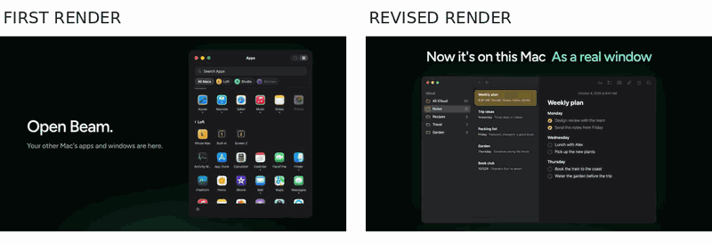

<!-- Native Markdown export of tab 00 from Hiten Shah’s The Product Launch Video Playbook. Source: https://docs.google.com/document/d/18jpuStgJUqbx-A5M_IGDLT98gNThoRh0D3C0k7sgRJs/edit?tab=t.0 . Exported 2026-11-18. Only internal links and exported image references repaired. -->

# The Product Launch Video Playbook

*How to turn product screenshots, recordings, and AI into a launch video people understand.*

By [**Hiten Shah**](https://www.hiten.com/) [(X)](https://x.com/hnshah)

Updated Monday, November 17, 2026 at 11:35am PT

**This Friday at 10am PT, I'm showing how we made the Beam launch video and edited my recorded sessions with AI, including what the first attempts missed and how we fixed them. [Join for free.](https://hiten.com/ai-video-editing-101/)**

We made a product launch video for [Beam](https://beam.win) using AI. The first cut showed the window picker, the Dock and how to switch between apps. It looked like something we could publish.

Then we noticed the most useful part was barely in the video. Beam puts a window from another Mac onto the one in front of you, where it works like any other window. The revision made that result much clearer.

After more than twenty years launching software, I know how easy it is to fill in what an explanation leaves out when you already know the product. Somebody encountering Beam for the first time doesn't have that context.

AI makes it easier to turn product screenshots, recordings and graphics into a launch video. We studied eight recent software launches to understand how their videos make a product worth noticing. I wrote this playbook to help with the whole process, from deciding what to show to reviewing the final cut.

**Start with the moment you need somebody to understand.**

## Find the play you need

| Your situation | Start here |
| :---- | :---- |
| **I need a video but can't say what to explain.** | [01](01-decide-the-promise.md) Decide the promise. Write a five-line Video Brief. |
| **I already have screenshots or recordings.** | [02](02-find-the-material.md) Find the material. Choose the real proof moment. |
| **I want examples worth borrowing.** | [03](03-borrow-the-structure.md) Borrow the structure. Study eight real launch-video examples. |
| **I have source files and want AI to build a first cut.** | [04](04-direct-the-first-cut.md) Direct the first cut. Plan scenes before rendering. |
| **The first render looks good but feels wrong.** | [05](05-review-and-improve.md) Review and improve. Use the Edit Log and a stranger test. |
| **I need the right length and distribution plan.** | [06](06-publish-and-learn.md) Publish and learn. Match the cut to its job. |
| **I want prompts, templates and a repeatable process.** | [07](07-the-working-kit.md) The working kit. Copy the brief, prompts and review checklist. |
| **I want the original videos and research.** | [08](08-examples-and-sources.md) Examples and sources. Open the real launch posts. |
| **I want a professional teardown of launch videos.** | [09](09-video-teardowns.md) Product Launch Video Teardowns. Study 14 films and what I'd test. |

## Start with your first Video Brief

Before opening an editor, answer these five questions.  
**Viewer and situation** — Who is watching, and what job are they trying to do?  
**Promise** — What should they understand or believe afterward?  
**Moment** — Which scene would you fight to keep if the video were half as long?  
**Evidence** — What real source shows or supports that moment?  
**Next action** — What should they do, and how will you tell whether the video helped?

### What ours looked like for Beam

**Viewer** — Someone using more than one Mac who needs an app on another machine.  
**Promise** — The remote app can appear as a regular window on this Mac.  
**Moment** — That window arriving and becoming usable.  
**Evidence** — Actual Beam screen recordings, including the remote app appearing locally.  
**Review question** — Can somebody unfamiliar with Beam explain what it makes possible?  
Use those answers to choose the most important source footage before making the first cut.

**This Friday at 10 AM PT, I'm showing how we made the Beam launch video and edited my recorded sessions with AI, including what the first attempts missed and how we fixed them. [Join for free.](https://hiten.com/ai-video-editing-101/)**