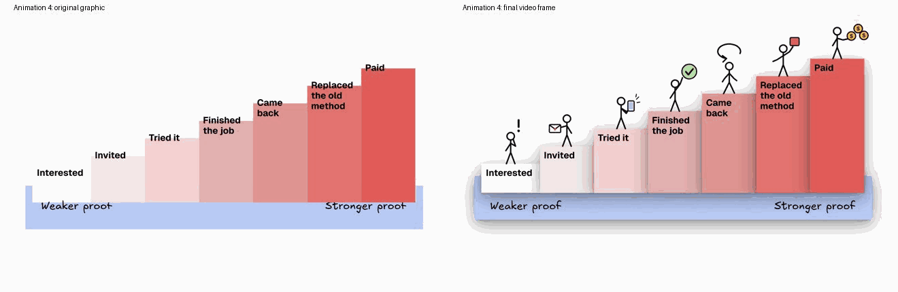

<!-- Native Markdown export of tab 02 from Hiten Shah’s The Product Launch Video Playbook. Source: https://docs.google.com/document/d/18jpuStgJUqbx-A5M_IGDLT98gNThoRh0D3C0k7sgRJs/edit?tab=t.6kaj5pyvpod2 . Exported 2026-11-18. Only internal links and exported image references repaired. -->

# 02  Find the moment worth showing

Before making a video, I want to know what we can actually show with the material we have.

Look through the screenshots, actual UI recordings, older product demos, explanatory graphics and voice footage you already have. Each has a different job.

## Evidence before effects

Screenshots show how the product looks at a particular moment. Recordings show what somebody does with it. A before-and-after pair makes a change visible, while a person speaking can explain why that change matters.

With Beam, the picker screenshots explained the setup. The footage of the remote window appearing on the local Mac showed the experience people would actually use.

## Match source material to a method

Existing recording: select moments, approve cuts, frame and caption. Check meaning and continuity.

Real UI/screenshots: propose timed scenes and animate crops, camera and text through code-controlled rendering where precise changes matter.

Static graphics: animate the actual elements in a meaningful sequence. Do not add movement that changes the diagram's argument.

Missing illustrative shot: consider generating one controlled scene, then inspect it for consistency and misleading claims. Don't generate counterfeit product UI.

## Make a source inventory

Ask the agent to list filenames, dimensions, duration, what each file shows and whether it is real product evidence or a style reference. Explicitly mark any missing source. A convincing-looking invented interface is still wrong.

## Five old graphics became animations

We used Claude Cowork with HyperFrames to animate five original graphics from past presentations. One gained stick figures acting out product adoption stages. Another showed dart throws and pass/fail results. Two needed an additional prompt to control motion or layout.

The ideas were already in the graphics. Animating them let us reveal each part in the order somebody would explain it.

*The original diagram named the stages of adoption. The animation adds figures acting them out, making the progression easier to follow.*

## Decide what you'll show

Make a list of three or four source moments. Choose the one most directly connected to your Video Brief. If none exists, produce an authentic recording or change the promise.

I'd make the scene plan from those real materials before asking AI to render anything.

**Next step**

With your best source moments identified, choose a story that fits the viewer's question.

[03 Borrow the structure →](03-borrow-the-structure.md)