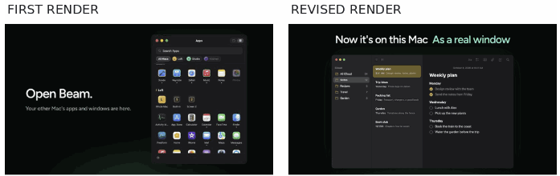

<!-- Native Markdown export of tab 05 from Hiten Shah’s The Product Launch Video Playbook. Source: https://docs.google.com/document/d/18jpuStgJUqbx-A5M_IGDLT98gNThoRh0D3C0k7sgRJs/edit?tab=t.zhy6a9tdj1ba . Exported 2026-11-18. Only internal links and exported image references repaired. -->

# 05  Fix what the first version missed

The first render gives you something specific to improve.

## The Beam mistake

We made a Beam launch video from screenshots and screen recordings. The first cut spent its time on app selection and navigation. Someone unfamiliar with Beam could watch the sequence and still miss what made the product useful.

The revision centered on a different moment. A window from another Mac appears on the computer in front of you and behaves like a local window. That scene explains more about Beam than the preceding navigation did.

*The first cut showed how to find an app. The revision showed what becomes possible when you open it.*

## The editing lesson

A launch video should make the product's value visible. Give that moment enough screen time to register. Every second spent getting there is worth questioning.

## Watch like someone who's never used it

Ask a new viewer to describe what the product does before you explain. Note the scene that led them to that conclusion.

Inspect at the actual mobile size if the video will appear in a feed. A 1920-pixel UI screenshot can still be unreadable after it has been split into tiny panes.

## Protect the meaning

In an earlier first-attempt editing comparison, one output preserved the intended point but missed the vertical format. Another produced the requested vertical shape but omitted a material part of the argument.

This was one test and is separate from our Zoom-versus-AI-produced teaser. A correct export can still be a misleading edit.

## Keep a revision record

* What we wanted the viewer to understand.  
* What the first cut actually showed.  
* The missing or confusing moment.  
* The change we made.  
* What the new viewer understood after the revision.

Make the smallest change that improves the result. A new effect or transition is useful only when it helps the viewer follow the story.

## When the video is ready

Check actual UI, spoken text, captions, timing, sound-off comprehension, framing and any time-sensitive claims. Stop when the video delivers its purpose clearly at the quality level appropriate to its audience.

**Next step**

When the cut communicates the result, decide where to publish it and what to measure.

[06 Publish and learn →](06-publish-and-learn.md)